# Radar do Território

> App Flutter que cruza clima, qualidade do ar e riscos de um município brasileiro para **antecipar alertas explicáveis**, sempre com a decisão final nas mãos de uma pessoa.

Global Solution 2026.2 · FIAP · Cross-Platform Application Development · Desafio **Territory Predictive Insights**

<!-- Banner: coloque a imagem em assets/screenshots/banner.png e descomente a linha abaixo -->
<!--  -->

---

## 1. Problema e público

**Problema.** Chuva forte, calor extremo e ar poluído costumam ser percebidos tarde. Os dados existem em fontes públicas, mas estão espalhados e sem explicação do que significam para o município.

**Para quem.** Gestores municipais e equipes de defesa civil e saúde que precisam acompanhar um ou mais municípios, de um ou mais estados, e decidir com antecedência.

**Impacto social esperado.** Dar dias de antecedência ao gestor e mostrar quantas pessoas vivem no município que está sob alerta (indicador de benefício social na visão geral), para priorizar a ação.

## 2. Integrantes

| Nome completo | RM |
|---|---|
| André Ayello de Nobrega | 561754 |
| Mirella Mascarenhas | 562092 |

## 3. Demonstração visual

> Prints em `assets/screenshots/`. Cada imagem tem uma legenda curta.

| | | |
|:--:|:--:|:--:|
| 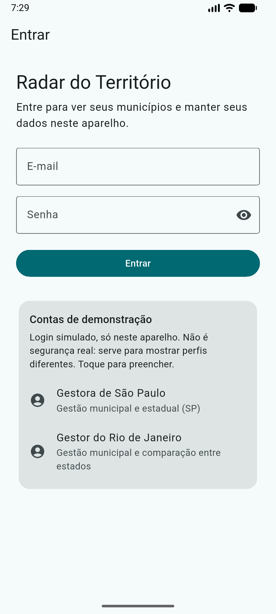<br>Login com perfis de demonstração | 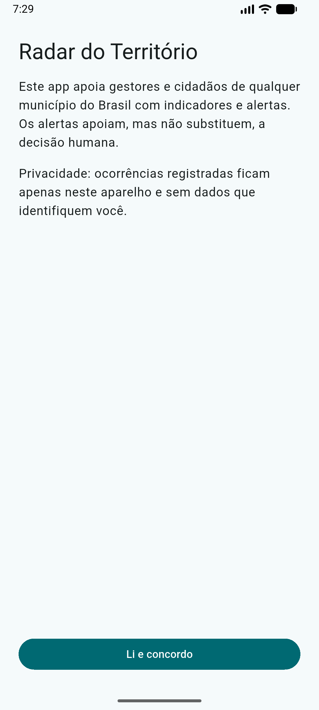<br>Consentimento de privacidade | 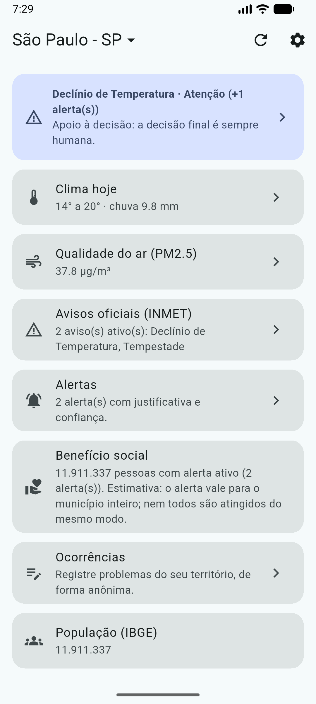<br>Visão geral e benefício social |
| 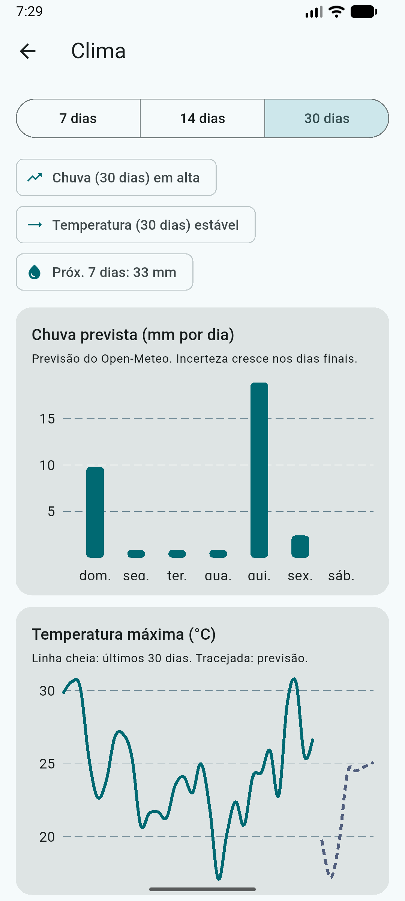<br>Dashboard de clima | 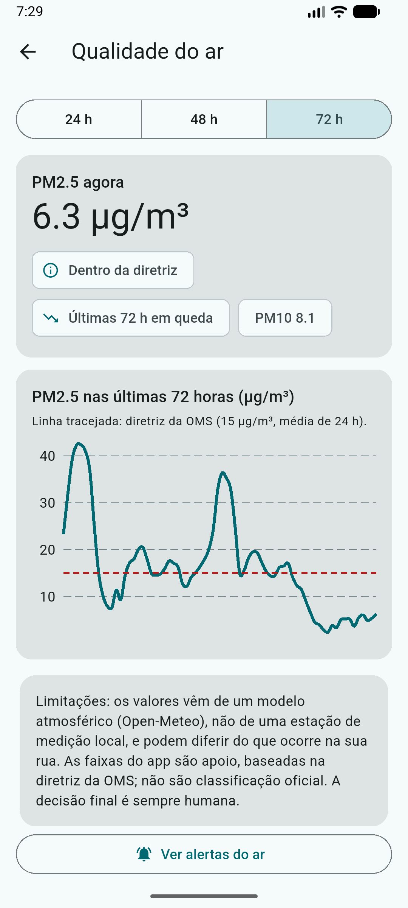<br>Dashboard de qualidade do ar | 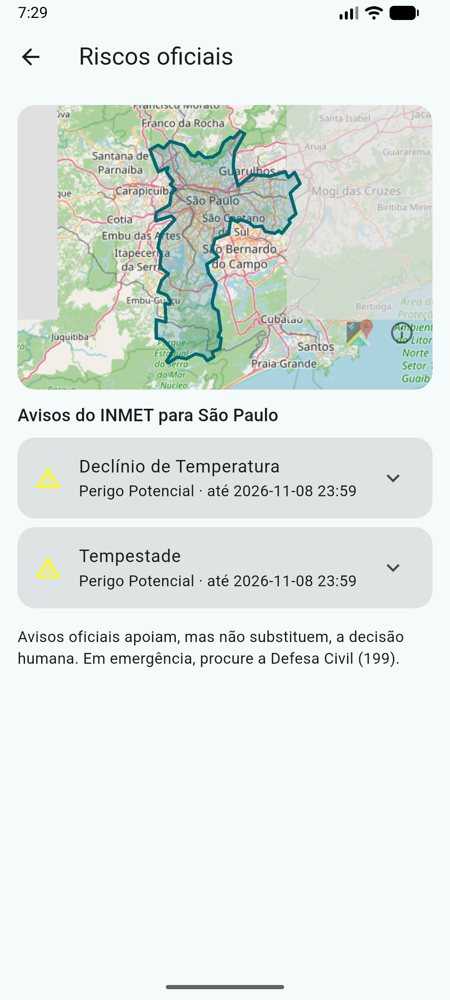<br>Mapa de riscos do município |
| 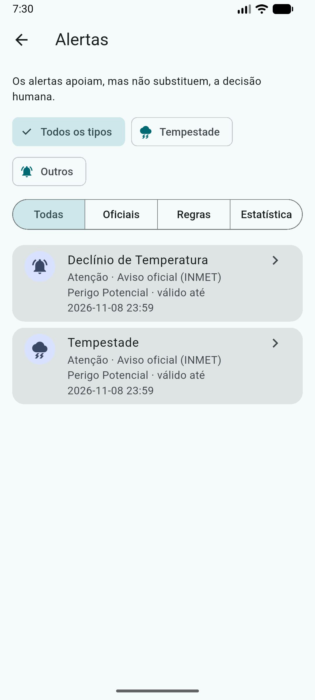<br>Lista de alertas | 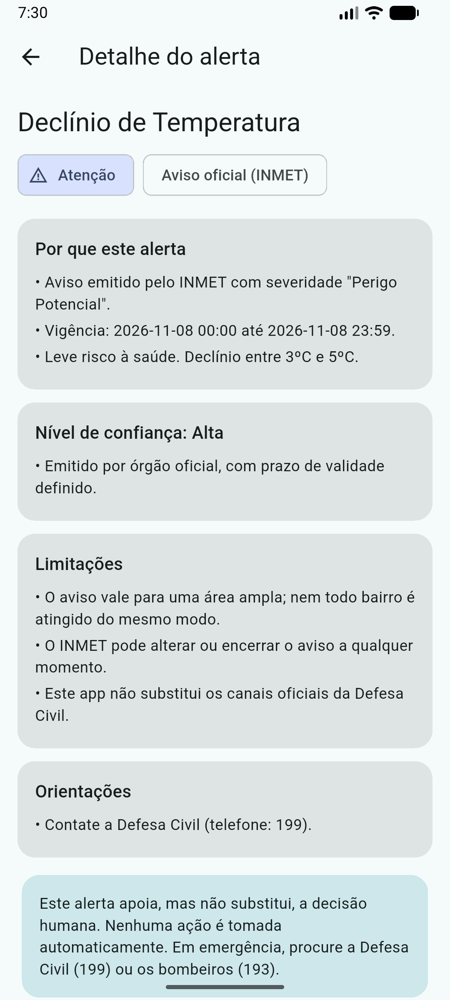<br>Justificativa, confiança e limitações | 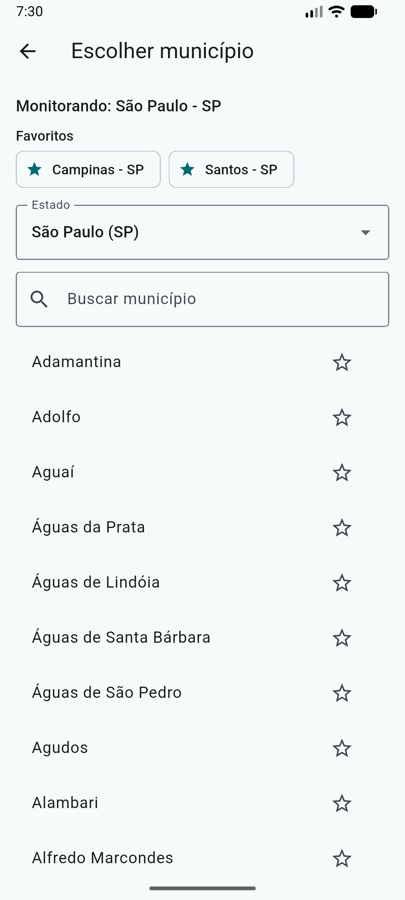<br>Escolha de estado, município e favoritos |
| 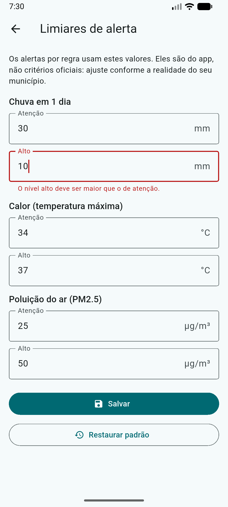<br>Limiares de alerta com validação | 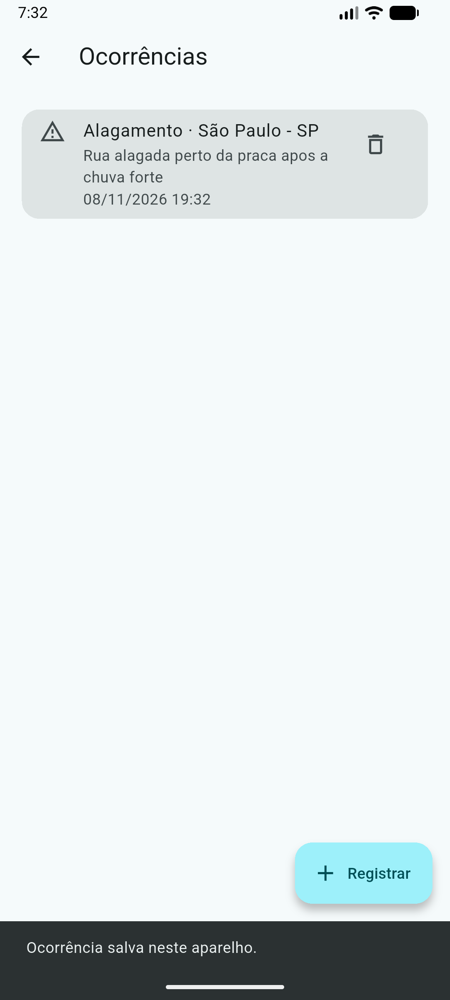<br>Ocorrências anônimas | 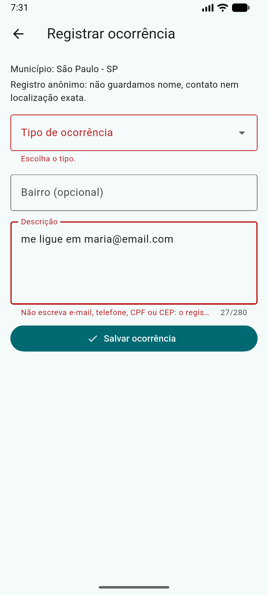<br>Formulário com erros de validação |
| 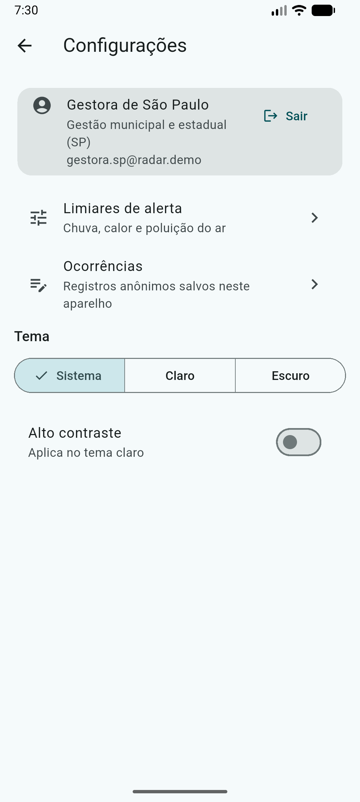<br>Configurações e perfil | 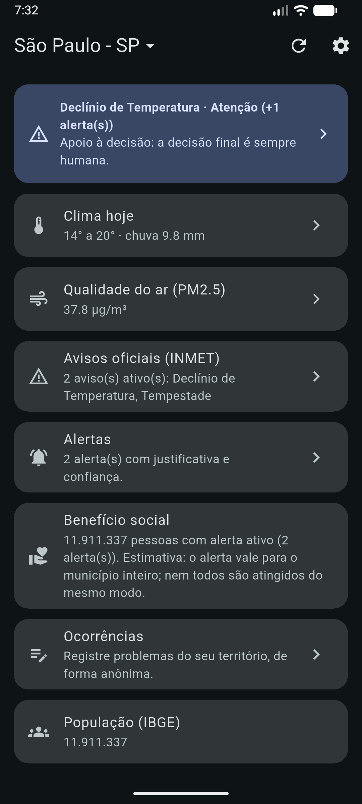<br>Modo escuro | |

## 4. Funcionalidades

- [x] Navegação com rotas nomeadas e parâmetros (`go_router`), com redirecionamento para consentimento e login
- [x] Login com e-mail e senha para dois perfis de demonstração, cada um com seus próprios dados
- [x] Escolha de qualquer estado e município do Brasil, com busca e favoritos
- [x] Quatro painéis: visão geral, clima (histórico e previsão), qualidade do ar e riscos (mapa com o contorno do município)
- [x] Gráficos e indicadores de tendência
- [x] Alertas por regras, por estatística e por avisos oficiais do INMET
- [x] Cada alerta mostra justificativa, evidências, nível de confiança, limitações e recomendações
- [x] Aviso visível de que os alertas **apoiam, mas não substituem, a decisão humana**
- [x] Estado global compartilhado (`provider`) com carregamento, erro (com nova tentativa) e lista vazia
- [x] Dados de APIs reais, com cache local por município: o app abre offline com o último dado baixado
- [x] Formulários com validação e mensagens de erro: limiares de alerta e registro de ocorrência
- [x] Indicador de benefício social (população coberta × alertas × antecedência)
- [x] Tema claro, escuro e de alto contraste
- [x] Acessibilidade testada: fonte 2x, dois tamanhos de tela, contraste, alvos de toque e rótulos
- [x] Testes automatizados de alertas, estatística, validações, login e acessibilidade

## 5. Dados e alertas

**Fontes (todas públicas, sem chave de API):**

| Fonte | Uso |
|---|---|
| IBGE Localidades | estados e municípios |
| IBGE Malhas (GeoJSON) | contorno do município e coordenadas |
| IBGE SIDRA | população do município |
| Open-Meteo (previsão, histórico e qualidade do ar) | temperatura, chuva, PM2.5 e PM10 |
| INMET (avisos ativos) | avisos oficiais filtrados pelo município |

**Como os alertas são gerados** (`lib/domain/alert_engine.dart`):

- **Regras com limiares** de chuva acumulada, temperatura máxima e PM2.5. Os limiares podem ser ajustados por perfil e são validados (por exemplo, o nível alto precisa ser maior que o de atenção).
- **Estatística simples, em Dart puro** (`lib/domain/stats.dart`):
  - regressão linear sobre 30 dias de histórico, com R², para a tendência de temperatura;
  - z-score para apontar dias previstos fora do padrão do mês;
  - suavização exponencial dupla (Holt) para projetar o PM2.5.
- **Avisos oficiais do INMET** são exibidos com a fonte indicada.

**Métricas por alerta:** valores observados ou previstos, limiar usado, R² ou z-score quando há estatística, e antecedência em dias.

**Limitações, vieses e quando não confiar:**

- Os alertas estatísticos nunca recebem confiança alta. É estatística simples sobre série curta, **não é aprendizado de máquina**, e não captura sazonalidade.
- Previsão de chuva e calor vem de modelo global e pode errar em escala de bairro.
- A qualidade do ar usa modelo, não medidor local; em cidades sem estação, o erro tende a ser maior.
- O contorno e a população são do município inteiro; riscos locais (encostas, alagamentos pontuais) não aparecem.
- Sem internet, o app mostra o último dado baixado, que pode estar desatualizado, e informa isso.
- As ocorrências registradas são locais ao aparelho e não alimentam os alertas.

## 6. Privacidade e inclusão

**Privacidade**

- Tela de **consentimento** antes de qualquer uso; sem consentimento o app não avança.
- Ocorrências são **anônimas**: o formulário bloqueia e-mail, telefone, CPF, CEP e sequências longas de dígitos, e não guarda nome, contato nem localização exata.
- Os dados ficam só no aparelho (`shared_preferences`), separados por perfil.
- O login é **simulado, apenas para demonstração**: não há servidor, nem hash, nem segurança real. Só o identificador do perfil fica salvo na sessão; a senha não é gravada.
- Não há chaves de API, tokens nem arquivos `.env` no código.

**Acessibilidade**

- Rótulos de leitor de tela (`Semantics`) em botões, cartões e gráficos.
- Texto legível com fonte ampliada em 2x, sem estouro de layout (testado).
- Contraste conforme WCAG AA nos temas claro e escuro, e tema de alto contraste.
- Alvos de toque de pelo menos 48 px.
- Layout testado em celular (360x640) e tablet (800x1100).

## 7. Tecnologias e decisões técnicas

| Escolha | Por quê |
|---|---|
| **Flutter / Dart** | um código para Android e Windows, e boa cobertura de testes de widget |
| **provider** | estado simples e suficiente para quatro estados globais (configurações, login, dados do usuário, território) |
| **go_router** | rotas nomeadas, parâmetros e redirecionamento (consentimento e login) |
| **dio** | cliente HTTP com tratamento de erro e timeout |
| **shared_preferences** | persistência local leve, com chaves por perfil (`u_<perfil>_...`) e cache por código IBGE |
| **fl_chart** | gráficos de linha e barras |
| **flutter_map + latlong2** | mapa do município sem chave de API |
| **intl** | datas e números em pt-BR |
| **mocktail** | testes com a API simulada |

**Arquitetura em camadas:**

```
lib/
  app/      rotas
  core/     tema, validadores, modelo de território
  data/     modelos, serviço de API e repositórios (cache)
  domain/   motor de alertas, estatística, indicador social
  state/    providers
  ui/       telas e widgets reutilizáveis
```

A lógica de alertas fica em `domain/`, sem depender de Flutter, o que permite testá-la isoladamente.

## 8. Como executar

Pré-requisito: [Flutter](https://docs.flutter.dev/get-started/install) estável (testado com 3.44). Não é preciso configurar variáveis de ambiente nem chaves de API.

```bash
git clone https://github.com/AndreNobrega125/GS-Hercules-CitizenTech.git
cd GS-Hercules-CitizenTech
flutter pub get
flutter run            # escolha o dispositivo ou emulador
# ou, no Windows:
flutter run -d windows
```

Testes e análise:

```bash
flutter analyze
flutter test
```

**Contas de demonstração** (senha das duas: `gestor123`):

| Perfil | E-mail |
|---|---|
| Gestora de São Paulo | `gestora.sp@radar.demo` |
| Gestor do Rio de Janeiro | `gestor.rj@radar.demo` |

Os dados precisam de internet na primeira vez que cada município é aberto. Depois disso, o app funciona offline com o último dado baixado.

## 9. Vídeo

<!-- Substitua pelo link público (YouTube ou Drive) -->
Link: _a incluir_

## 10. Licença

Projeto acadêmico, FIAP, Global Solution 2026.2.
